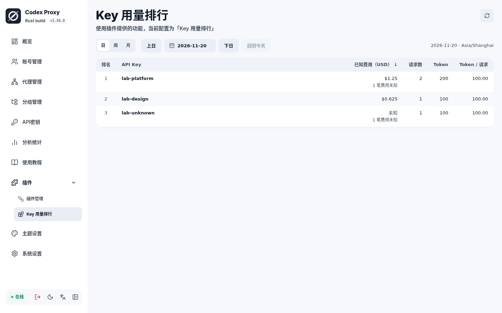

# 密钥用量排行

在 Codex Proxy RS 3.50.x 的管理员页面查看日榜、自然周榜和自然月榜。按已知 USD 费用降序列出有用量的密钥，并显示请求数、Token 数和费用未知的请求数。只有未知费用时显示「未知」，已知金额为零时显示零

在管理端的「插件」中上传并启用 dist 中的 Linux x86_64 安装包，打开「Key 用量排行」。周一为每周第一天。插件默认时区为 Asia/Shanghai，若宿主使用其他时区，请将插件配置 timezone 设为 host.timezone 的值

排行沿用宿主用量统计，以请求开始时间归属，包含可归属到 Key 的聚合贡献，只合计 USD。它与按请求完成时间扣减的 Key 预算可能有差异。页面只有管理员可以访问

插件启用后会自动把已结束的自然日按 Key ID 归档，临近宿主清理时刷新。月榜把超出保留期的归档与仍可查询的数据合并。保持同一插件实例并保留其私有状态，停用会暂停归档，删除实例会删除归档。安装前已经清理的用量无法恢复。宿主默认保留 31 天，保留期应超过一个完整自然日。没有完整归档的历史月份会提示数据不足

从源码构建需要 Rust 1.99.1、Node 和前端 package.json 指定的 pnpm，以及与宿主兼容的 cpr-plugin CLI。在项目目录运行 scripts/package，安装包和 SHA-256 文件生成在 dist 中
